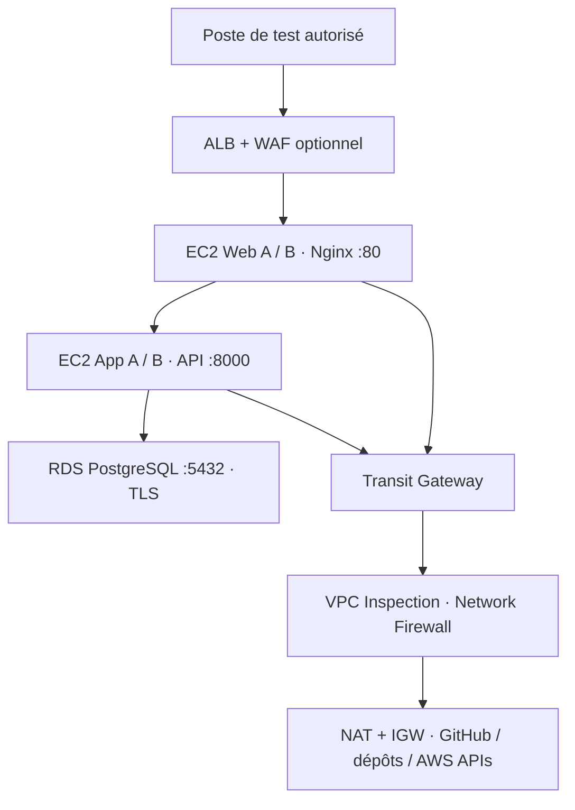

# LabShop — AWS Secure 3 Tier

Application pédagogique complète pour le projet **EL-MANSOUR OTHMAN** : frontend HTML/CSS/JavaScript, API Flask, PostgreSQL RDS, déploiement GitHub → SSM State Manager → EC2.

**Le dépôt est publiable sur GitHub. L'application vulnérable doit rester un laboratoire accessible uniquement depuis ton IP.** Aucune donnée réelle ni carte bancaire. Les comptes de démonstration sont publics et intentionnels.

## Démarrage local

Prérequis : Docker Desktop + Docker Compose. Dans WSL ou Git Bash :

```bash
docker compose up --build -d
# Ouvrir http://localhost:8080
python scripts/smoke.py http://localhost:8080
```

Comptes : `alice@labshop.test` / `bob@labshop.test`, mot de passe commun `LabShop-Demo-2026!`.

```bash
# Activer les trois vulnérabilités de démonstration
LAB_MODE=vulnerable docker compose up -d --force-recreate app
python scripts/smoke.py http://localhost:8080 --sqli
# Revenir aux protections applicatives
LAB_MODE=secure docker compose up -d --force-recreate app
# Arrêter en conservant les données
docker compose down
```

`docker compose down -v` supprime les données locales. Le mode local utilise un compte PostgreSQL propriétaire par simplicité ; AWS provisionne un compte SQL limité. Le mode « secure » corrige les trois failles étudiées, ce n'est pas une certification de sécurité ni une application de production.

## Architecture



Dans le routage existant, les flux locaux Web → App → RDS restent dans le VPC Application : ils ne passent pas automatiquement par le VPC Inspection. SSM nécessite aussi sa connectivité HTTPS ; des VPC endpoints peuvent remplacer certains accès Internet.

## Contenu

| Dossier | Rôle |
|---|---|
| `frontend/` | Catalogue, recherche, panier, connexion, commandes et avis |
| `backend/` | API, sessions partagées en DB, modes secure/vulnerable |
| `sql/` | Tables, index, contraintes, données synthétiques |
| `scripts/` | Installation AL2023, migrations, provisioning SQL, systemd, Nginx, smoke tests |
| `infra/module/` | Module Terraform pour les associations SSM, IAM et secret applicatif |
| `infra/integration/` | Raccordement aux noms de ressources de ton projet existant |
| `tests/` | Tests d'intégration API sur PostgreSQL |
| `.github/workflows/` | Tests automatiques lors des push et pull requests |
| `docs/` | Déploiement, API, scénarios, exploitation, vérifications et sources |

## Publier sur GitHub

Créer un dépôt **public vide** nommé `labshop` dans ton compte, puis exécuter depuis ce dossier :

```bash
git init -b main
git add .
git commit -m "Add LabShop AWS three-tier security lab"
git remote add origin https://github.com/TON_COMPTE/labshop.git
git push -u origin main
git rev-parse HEAD
```

Le module fourni utilise HTTPS anonyme : un dépôt privé nécessiterait un mécanisme d'authentification supplémentaire. Ne mets pas de token dans l'URL. Publier le code ne déploie pas l'application et ne lance aucune ressource AWS.

**Étape suivante : [docs/DEPLOIEMENT_AWS.md](docs/DEPLOIEMENT_AWS.md)**. Les fichiers sont adaptés à `aws_instance.application`, `aws_instance.web`, `aws_db_instance.database`, `awslab`, et au health check `/api/health` de l'archive fournie. Les instances B sont optionnelles : les noms commentés sont à adapter à ta version réelle. Le ZIP source reçu ne contient pas les modules réseau ; ce dépôt ne prétend donc pas remplacer ton infrastructure complète.

## Fonctionnement des mises à jour

Chaque déploiement récupère un **SHA Git précis**, avec `git fetch` puis checkout. C'est l'équivalent reproductible du pull demandé : une instance recréée récupère exactement la version indiquée. Un simple push sur GitHub ne déclenche pas SSM : mettre à jour `labshop_commit`, puis `terraform apply`. Les anciennes versions restent sous `/opt/labshop/releases/`.

Les migrations conservent les données existantes. La suppression/recréation de RDS crée une base neuve et rejoue les données de démonstration. Une mise à jour de l'API peut provoquer une interruption courte ; ce mécanisme n'est pas un déploiement blue/green.

## Documentation

- [Installer dans ton Terraform](docs/DEPLOIEMENT_AWS.md)
- [API et modèle SQL](docs/API_SQL.md) · [OpenAPI JSON](docs/openapi.json)
- [Scénarios de sécurité et résultats attendus](docs/SCENARIOS.md)
- [Exploitation et dépannage](docs/EXPLOITATION.md)
- [Résultats de vérification](docs/VALIDATION.md)
- [Sources officielles](docs/SOURCES.md)
